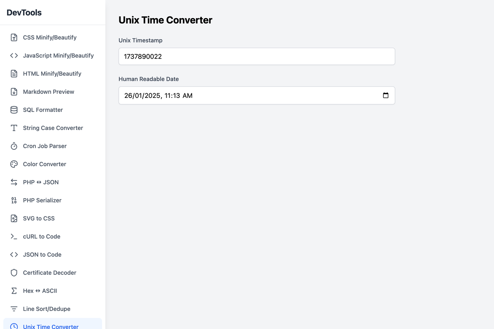

<div align="center">

# DevUtils


**Your data stays in your tab.** Paste a token, a query or a config, and nothing leaves your browser.

[`Live demo`](https://devutils-one.vercel.app) [`MIT`](LICENSE) `React 18` `TypeScript`

</div>

<br>

Online formatters and decoders want you to paste real data into someone else's server. DevUtils does the work in your browser, so a JWT, a SQL query or a certificate never gets uploaded.

<br>


**1. Open the site:**

[devutils-one.vercel.app](https://devutils-one.vercel.app)

**2. Pick a tool from the list and paste your text into it.** You get the formatted, decoded or converted result right on the page.

**Want to run it on your own machine?** You need Node 18 or newer and pnpm. Paste each line as is:

```bash
git clone https://github.com/nadimtuhin/devutils.git
```

```bash
cd devutils
```

```bash
pnpm install
```

```bash
pnpm dev
```

Then open http://localhost:5173.

<br>


**It is a static web app.** The code runs in your browser. The formatters, converters and decoders are plain JavaScript libraries bundled with the page.

**You can check.** The source is MIT licensed and open. Read it, or run it yourself with the steps above.

<br>


<details>
<summary>"pnpm: command not found"</summary>

Install pnpm with `npm install -g pnpm`, then run `pnpm install` again. See [pnpm.io](https://pnpm.io/installation) for other ways.

</details>

<details>
<summary>The page does not open at localhost:5173</summary>

Look at the line `pnpm dev` printed. If port 5173 was busy, Vite picks the next free port and prints it there.

</details>

<details>
<summary>My tool is missing</summary>

Open a [new tool issue](https://github.com/nadimtuhin/devutils/issues/new/choose), or add it yourself. See [CONTRIBUTING.md](./CONTRIBUTING.md).

</details>

<br>


Everything below is reference. You don't need it to get started.

[Why DevUtils](#why-devutils) · [Tools](#tools) · [Quick start](#quick-start) · [Stack](#stack) · [Contributing](#contributing) · [Screenshots](#screenshots)

[](https://github.com/nadimtuhin/devutils/actions/workflows/ci.yml)
[](./LICENSE)
[](https://www.typescriptlang.org/)
[](https://react.dev/)
[](https://devutils-one.vercel.app)

**38 privacy-first developer tools. All processing happens in your browser, zero data sent to any server.**

## Why DevUtils

- **Privacy-first**: No data ever leaves your browser. Every operation runs locally.
- **Works without a network once loaded**: after the first visit, no connection is needed.
- **38 tools**: Formatters, converters, encoders, decoders, and more in one place.
- **Free & open source**: MIT licensed, community-driven, no paywalls.

## Tools

| Category | Tools |
|---|---|
| **Code Formatting** | SQL Formatter, JSON Validator & Beautifier, YAML Formatter, HTML Min/Beautify, CSS Processor, JavaScript Formatter |
| **Data Conversion** | Base64 Encoder/Decoder, Base64 Image, CSV↔JSON, YAML↔JSON, PHP Array↔JSON, PHP Serializer, SVG→CSS, Hex↔ASCII, cURL→Code, JSON→Code, HTML→JSX |
| **Security & Crypto** | JWT Debugger, Certificate Decoder, Certificate Generator, Hash Generator (MD5/SHA), UUID/ULID Generator |
| **Text & Utilities** | RegExp Tester, Cron Parser, Unix Timestamp, URL Parser/Encoder, Color Converter, Text Diff, Line Sorter, String Case Converter, Number Base Converter, Lorem Ipsum, HTML Entity Converter, Backslash Encoder, Markdown Preview, HTML Preview |

## Quick Start

```bash
git clone https://github.com/nadimtuhin/devutils.git
cd devutils
pnpm install
pnpm dev
```

App is available at http://localhost:5173

## Stack

| | |
|---|---|
| **Framework** | React 18 |
| **Language** | TypeScript |
| **Bundler** | Vite 6 |
| **Styling** | TailwindCSS |
| **Routing** | React Router |
| **Testing** | Jest + React Testing Library |

## Contributing

Contributions are welcome. See [CONTRIBUTING.md](./CONTRIBUTING.md) for guidelines.

Adding a new tool takes ~30 minutes. The codebase is structured to make it straightforward.

## Screenshots

| | |
|:---:|:---:|
|  |  |
|  |  |
|  |  |

## License

MIT, see [LICENSE](./LICENSE) for details.

<div align="center">

Built with ❤️ for developers, by developers | Privacy-first • Open Source • Works without a network once loaded

</div>
